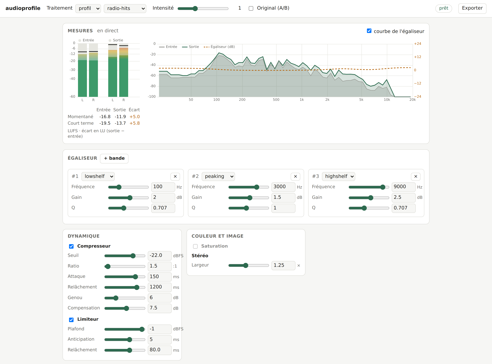

# Régler en direct : fichier, rechargement à chaud, panneau

[← Retour au README](../README.md)

## Fichier de réglages (`-config`)

`-config reglages.yaml` change les réglages des profils, des préréglages d'ampli et les valeurs par défaut des effets, sans toucher au code. **Tout ce que le fichier ne précise pas garde sa valeur codée en dur** : un fichier vide ne change rien. Sans `-config`, rien n'est lu.

```sh
./audioprofile -dump-config > reglages.yaml   # tous les réglages actuels, prêts à être édités
# (garder seulement ce qu'on change, ou tout garder)
ffmpeg -loglevel error -i musique.mp3 -f s16le -ar 44100 -ac 2 - \
  | ./audioprofile -config reglages.yaml -profile rock \
  | ffplay -f s16le -ar 44100 -ac 2 -nodisp -
```

```yaml
profiles:
  rock:                          # un profil prédéfini : seules les clés écrites changent
    compression: {ratio: 4}
    saturation: {drive: 8}
  jazz-sombre:                   # un nom nouveau : un profil de plus, utilisable avec -profile
    base: jazz                   # (facultatif) part d'un profil prédéfini
    bands:
      - {type: highshelf, freq: 8000, gain: -3}
amps:
  crunch: {drive: 11}
fx:
  delay: {time: 350, pingpong: true}   # défauts de -fx delay ; la ligne de commande l'emporte
```

- **Fusion** : les champs d'une section (`compression`, `saturation`, `limiter`…) se fusionnent avec les valeurs du profil ; les bandes de `multiband` se fusionnent bande par bande, de la plus grave à la plus aiguë (une liste plus courte que le profil ne change que les premières bandes : les suivantes gardent leur valeur de départ, et `{}` laisse une bande inchangée) ; la liste `bands` de l'égaliseur est **remplacée en bloc**. `enabled: false` supprime un étage (`compression`, `saturation`, `multiband`, `limiter`), `width: 0` supprime l'élargissement. Un étage que le profil n'a pas démarre de valeurs neutres (compresseur : −20 dBFS, 2:1, 10 ms, 100 ms, genou 6 dB ; limiteur : −1 dBFS, 5 ms, 100 ms).
- **Validation** : les clés inconnues, les types de bande inconnus et les valeurs hors bornes (gain, fréquence au-delà de Nyquist, ratio, plafond…) sont refusés avec un message, pour tous les profils du fichier même s'ils ne servent pas.
- **Amplis** : `-cabinet` active le baffle même si le fichier le désactive ; sans `-cabinet`, c'est le fichier qui décide.
- `-list` et `-list-amps` montrent aussi les noms définis par le fichier. L'exemple complet et commenté est [audioprofile.example.yaml](../audioprofile.example.yaml).

### Rechargement à chaud (`-watch`)

Avec `-watch`, le fichier est surveillé : quand on l'enregistre, les nouveaux réglages s'appliquent **en cours de lecture**, sans relancer ni clic. On règle ainsi à l'oreille : éditer, enregistrer, écouter.

```sh
ffmpeg -loglevel error -i musique.mp3 -f s16le -ar 44100 -ac 2 - \
  | ./audioprofile -config reglages.yaml -watch -profile rock \
  | ffplay -f s16le -ar 44100 -ac 2 -nodisp -
# autre terminal : éditer reglages.yaml, enregistrer → « -config reglages.yaml : rechargé » sur la sortie d'erreur
```

- **Sans clic** : la nouvelle chaîne est d'abord mise en régime sur les 2 dernières secondes déjà traitées (filtres, enveloppes des compresseurs, AGC, lignes à retard), puis un fondu de 30 ms fait passer de l'ancienne à la nouvelle sortie, sur le même instant du signal. Le flux garde la longueur de la source et aucune latence n'est ajoutée. Chaque changement coûte, une fois, de 25 à 55 ms de calcul (profil `rock` et `radio-hits`, mesuré).
- **Ce qui est rechargé** : les profils, amplis et valeurs par défaut de `-fx` du fichier. Le profil ou l'ampli choisi, `-intensity` et la liste des `-fx` restent ceux de la ligne de commande.
- **Fichier invalide** (YAML cassé, valeur hors bornes, profil disparu) : l'erreur est signalée sur la sortie d'erreur et **les réglages précédents restent**. Corriger le fichier suffit. L'enregistrement en deux temps de certains éditeurs (fichier vidé puis rempli) est toléré : on attend que le fichier soit stable pendant 250 ms.
- **Délai d'écoute** : la sortie est écrite par paquets de 8 Ko (46 ms), mais ffplay lit environ 1 s d'avance et le tube en garde un peu : le réglage s'entend avec ce retard (voir `-ab-delay` pour le même sujet).
- **Limites** : une queue de plus de 2 s (réverb très longue, écho à forte rétroaction) repart de ce que l'historique permet de reconstruire. `-watch` est incompatible avec `-ab` et `-target-lufs`, qui lisent tout le flux avant de sortir.

Côté bibliothèque, `Profile.Settings()` renvoie les réglages complets d'un profil (une copie à modifier librement) et `ApplyProfileSettings` les applique : `ApplyProfile(src, …, p, i)` équivaut à `ApplyProfileSettings(src, …, p.Settings(), i)`. `NewSwitcher(src, rate, channels, build)` renvoie un flux dont la chaîne se remplace à chaud avec `Swap(build)` (sûr depuis un autre goroutine) : c'est ce que fait `-watch`, et ce que brancherait un panneau de réglage.


## Panneau de réglage (`-serve`)

`-serve 127.0.0.1:8080` ouvre un petit serveur local et une page de curseurs : on règle le profil, l'ampli et les effets **en écoutant**, sans éditer de fichier. Chaque changement s'applique en cours de lecture, sans clic (même mécanisme que `-watch`).



```sh
# boucler un morceau pour régler tranquillement
ffmpeg -loglevel error -stream_loop -1 -i musique.mp3 -f s16le -ar 44100 -ac 2 - \
  | ./audioprofile -serve 127.0.0.1:8080 -profile rock \
  | ffplay -f s16le -ar 44100 -ac 2 -nodisp -
# audioprofile écrit « panneau de réglage : http://127.0.0.1:8080/ » : ouvrir cette adresse
```

- **Ce qu'on règle** : le profil (bandes d'égalisation à ajouter, retirer ou changer de type, compresseur, limiteur, saturation, largeur stéréo, compression multibande) ou l'ampli (drive, étages, biais, timbre, baffle), l'intensité, et la chaîne d'effets (ajout, retrait, ordre, activation et paramètres de chacun). On peut changer de profil ou d'ampli dans la page ; un étage absent d'un profil s'active par sa case.
- **Mesures** : en haut de la page, ce que fait la chaîne, vu **avant et après** le traitement et mis à jour une vingtaine de fois par seconde :
  - des **vumètres** par canal (niveau efficace, crête avec son maintien, voyant d'écrêtage) ;
  - la **sonie** momentanée (400 ms) et à court terme (3 s) en LUFS, et leur écart sortie − entrée en LU ;
  - le **spectre** en 64 bandes (20 Hz à 20 kHz, échelle logarithmique), l'entrée en gris et la sortie en couleur, avec par-dessus, sur son propre axe (± 24 dB), la **courbe de l'égaliseur** en vigueur : on voit l'effet d'un réglage de bande pendant qu'on le fait. La case « courbe de l'égaliseur » la masque ; elle n'existe que pour un profil (pas pour un ampli ni l'original).

  Avec `-serve`, les mesures sont branchées automatiquement. Dans un programme à vous, créez deux `Meter` (voir [Mesure en continu](mesure.md#mesure-en-continu-meter)), enveloppez la source avec le premier et le flux traité avec le second, puis `Tuner.SetMeters(in, out)` avant de servir : la page reçoit les images par un flux d'événements (`GET /api/meters`, Server-Sent Events) et masque la section si le `Backend` ne mesure pas. La crête est une crête d'échantillon, pas une crête inter-échantillons.
- **Comparer** : la case « Original (A/B) » coupe tout le traitement sans toucher aux réglages, pour juger à niveau égal du résultat.
- **Garder un réglage** : « Exporter » donne le YAML du profil ou de l'ampli (à coller dans le fichier de `-config`) et la ligne de commande équivalente, effets compris.
- **Départ** : l'état de départ est celui de la ligne de commande, `-config` compris. Sans `-profile` ni `-amp`, on part sans traitement et on choisit dans la page.
- **Réglages refusés** : une valeur hors bornes (ou deux paramètres incompatibles, comme `depth` plus grand que `delay` d'un chorus) s'affiche en rouge et ne change rien à ce qu'on entend.
- **Curseurs** : fréquences et durées à échelle logarithmique. Une valeur tapée hors du curseur élargit le curseur ; seul le serveur juge. Les envois sont limités à un toutes les 140 ms environ, car chaque changement rejoue 2 s de signal (voir `-watch`).
- **Sécurité** : le serveur n'a pas de mot de passe. Il est fait pour une adresse de bouclage (`127.0.0.1`) : il refuse alors les requêtes dont l'hôte n'est pas `localhost`, `127.0.0.1` ou `::1` (rebond DNS) ou dont l'origine est étrangère, et n'accepte les modifications qu'en JSON. Il ne peut que régler le son de ce processus, il n'écrit aucun fichier. Ne l'exposez pas sur un réseau.
- `-serve` est incompatible avec `-watch` (le panneau et le fichier se corrigeraient mutuellement), `-ab` et `-target-lufs`. `-serve 127.0.0.1:0` choisit un port libre.
